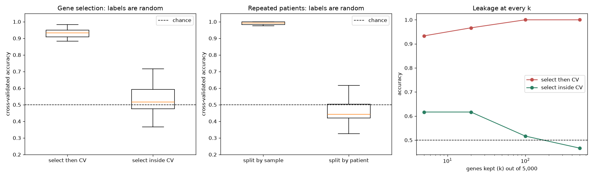

# Feature Selection Leakage

> 90% accuracy. 5,000 genes. Labels assigned at random. Your classifier didn't learn biology. It learned your mistake.

## Demo Output

Produced from simulated data by `demo.py`: cross-validated accuracy on datasets where the labels are pure noise, done wrong and done right.

## Why This Exists

Two mistakes produce most of the too-good-to-be-true biomarker papers:

1. **Choosing genes before cross-validation.** If you pick the top genes using every sample, the test folds have already shaped the model. With thousands of genes and dozens of samples, some genes will separate random labels by chance, and you just picked them.
2. **Splitting by sample when patients repeat.** Biopsies, time points and technical replicates from one patient share a strong individual signature. Put one in training and one in test, and the model recognises the *patient*, not the disease.

Both inflate accuracy far above chance on data with no signal at all. Both have simple fixes.

## The Fixes

| Leak | Fix | sklearn tool |
|------|-----|--------------|
| Selection outside CV | Put selection *inside* the pipeline | `make_pipeline(SelectKBest(...), model)` |
| Scaling/normalising on all data | Same: fit it inside each fold | `StandardScaler` in the pipeline |
| Repeated patients | Keep each patient in one fold | `GroupKFold`, `StratifiedGroupKFold` |
| Hyperparameter tuning on the test score | Nested CV, or a held-out set touched once | `GridSearchCV` inside `cross_val_score` |

## When NOT to Use This

This repo is about *catching* leaks, not about building good models. Once your evaluation is honest, you'll still need real signal, external validation, and a sample size that matches the number of features you're searching.

## The Uncomfortable Truth

If your pipeline gets well above 50% on shuffled labels, nothing it reports can be trusted. Run that check before you show the results to anyone.

## Further Reading

- Ambroise C. & McLachlan G. J. "Selection bias in gene extraction on the basis of microarray gene-expression data." PNAS (2002).
- Simon R. et al. "Pitfalls in the use of DNA microarray data for diagnostic and prognostic classification." Journal of the National Cancer Institute (2003).
- Kaufman S. et al. "Leakage in data mining: formulation, detection, and avoidance." ACM Transactions on Knowledge Discovery from Data (2012).
